# c2invoice

**Turn Claude Code usage into an invoice.**

Local time tracking, cost analysis and invoicing for freelancers who work with
Claude Code. It reads the session logs, reconstructs actual working time, and
produces an invoice PDF. No cloud, no account, no telemetry.


Token counters tell you what you consumed. `c2invoice` answers the question a
freelancer actually has: *what can I bill for this, and what's left after
costs?*

It reads Claude Code's session logs after they are written — no hooks, no
wrapper, no interference with running sessions, and **it costs you zero extra
tokens**. Everything runs locally on `127.0.0.1`; nothing is uploaded anywhere.

```
session logs → active working time → hourly value → margin → invoice PDF
```

## What it looks like

The sidebar has four groups. **Assistant**: Cira, Sessions, Live and Time
tracking. **Work**: Board, Jobs and Tools. **Analysis**: Finances and Usage.
**Billing**: Quotes, Invoices and Contacts. One period selector applies to
every page, with an optional comparison to the previous period; **Ctrl+K / ⌘K**
searches jobs, documents, contacts and settings.

**Cira** is the assistant built into c2invoice. Ask in plain words or pick a
suggestion, such as *Wie lief der Monat?* (how did the month go?), *Was ist
überfällig?* (what is overdue?) or *Rechnung für PROJ-12* (invoice for
PROJ-12). Cira speaks German for now, even with the English interface. The
answer comes in tiers. **T0** answers straight from your own figures, without a model and
free of charge. **T1** uses local models via Ollama, if you have them, and **T2**
uses Claude, only if you allow it and only up to a monthly limit you set. Every
answer shows its tier and source, and *How was this derived?* opens the
calculation behind a figure. Nothing leaves the tool without your approval:
an invoice Cira drafts waits under *Needs you* until you release it.

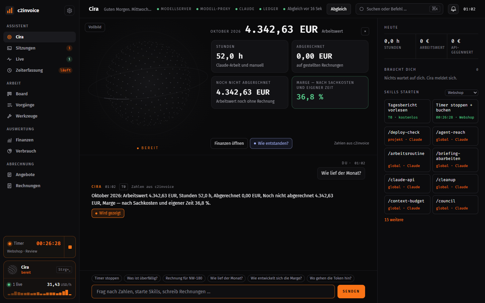

**Sessions** starts Claude Code from c2invoice and books every session onto a
job, from the git branch or the board card. You follow it like in the
terminal or as cards; when Claude asks for permission, the question appears
here and as a notification, with *Allow* and *Deny*. On the right: what this
session has cost so far, what it loaded, and what to do with the result (a
summary into the job log, a line on the invoice draft, notes for the next
session, or *continue in the terminal*). Sessions you start in your own
terminal show up too, read-only:

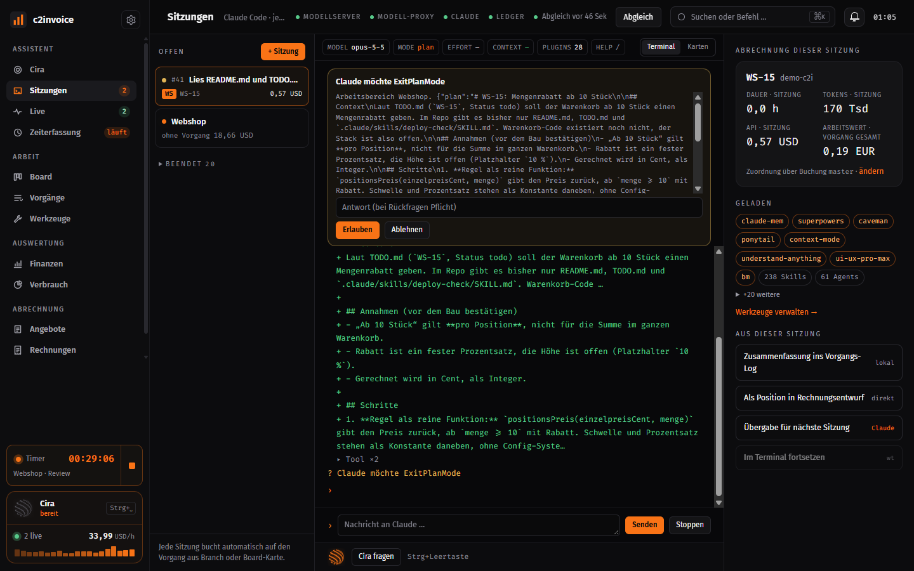

The **Board** collects tasks from a `TODO.md` per workspace and, if you use it,
from Jira, as one Kanban with time and value from c2invoice on every card. Drag
a card to change its status, start it in Claude with ▶, or turn a local task
into a Jira issue; the time already booked moves along. Filters for sprint and
backlog, grouping by epic, assignee, priority or workspace:

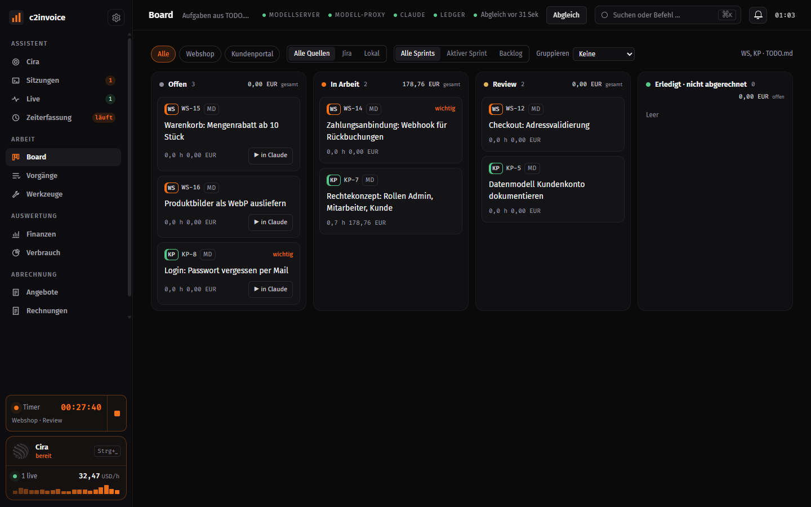

**Tools** lists what Claude Code loads per workspace: skills, agents,
commands, plugins, mods and MCP servers, with usage and cost over 30 days and
the context each one costs before your first prompt (*Measure context*). Switch
a tool on or off per workspace (a backup is written before every change),
install a skill from your skill store, and let Cira point out tools that cost
context but are hardly used. The matrix shows where a tool is active and where
it is inherited:

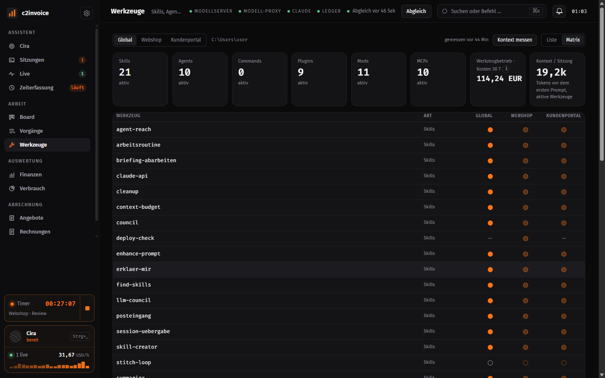

**Finances** (the Hub of earlier versions) is the overview of the money side.
Revenue for the period up top, then
*instruments* that answer "am I on track?" against a target — margin, active
hours, burn rate, billing ratio, open items. Below them, *my metrics*: your
own selection of figures and charts, added, reordered and resized as you like.
In between, today's working time against the daily target, manual time by
activity and the workload of the next seven days:

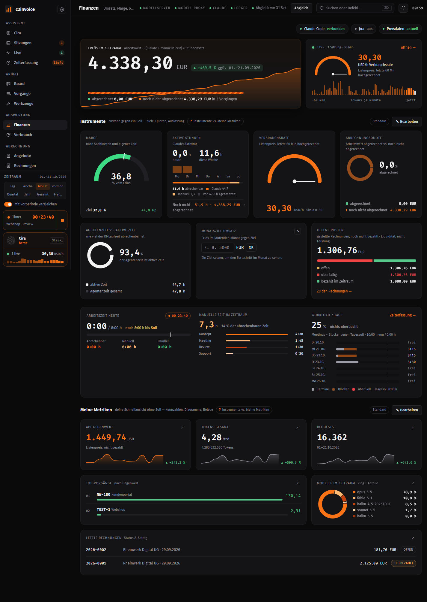

Per job — Claude only or with manual time, the job's time model as a switch, a
timeline from *recorded* to *paid*, a margin gauge against your target, the way
from revenue to margin, and every session and manual entry:

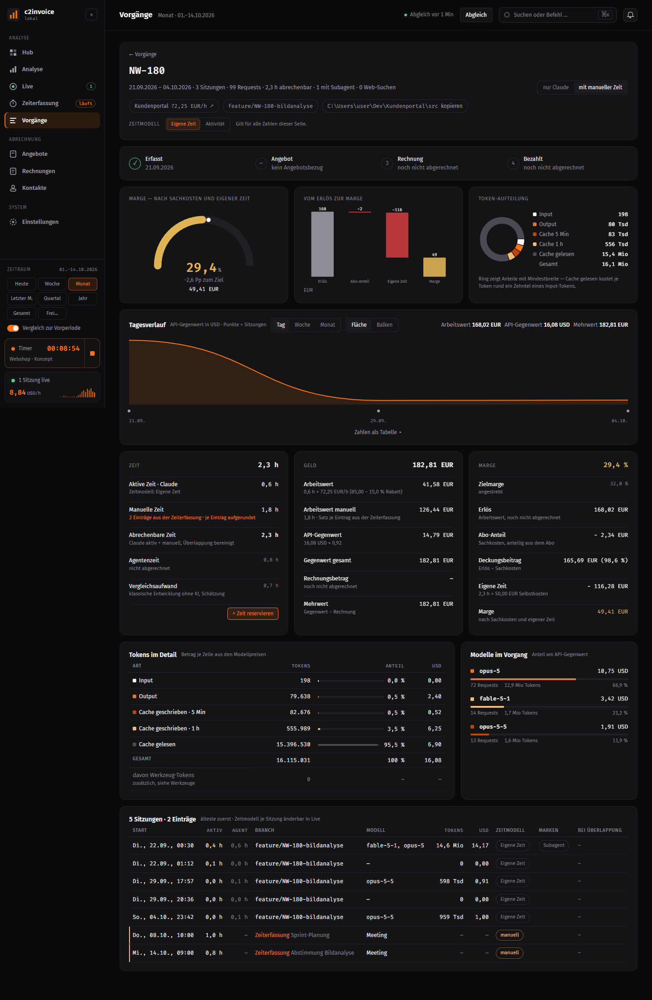

Time tracking — the hours Claude does not see: meetings, reviews, support
calls. A timer or an entry after the fact, booked onto a job, project or
customer. The week shows your entries next to the Claude sessions and your
calendar; where both overlap, you decide what gets billed:

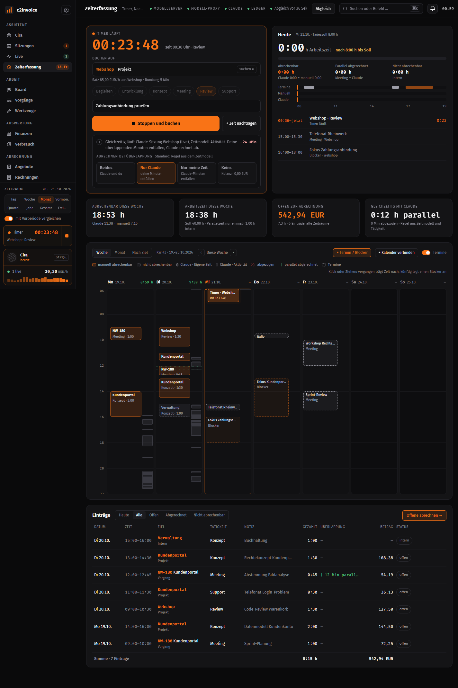

Getting paid — payments are recorded per invoice, partial payments included.
Status follows from the payments (*open*, *partly paid*, *paid*), and an
invoice past its due date that is not fully paid shows as overdue:

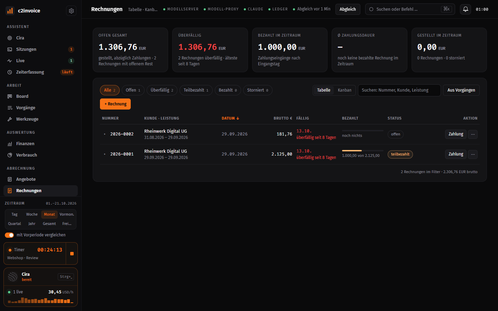

The document editor builds quotes and invoices from jobs in a period, manual
time, saved line templates, flat fees or free lines — with a live preview
rendered by the same code that prints the PDF:

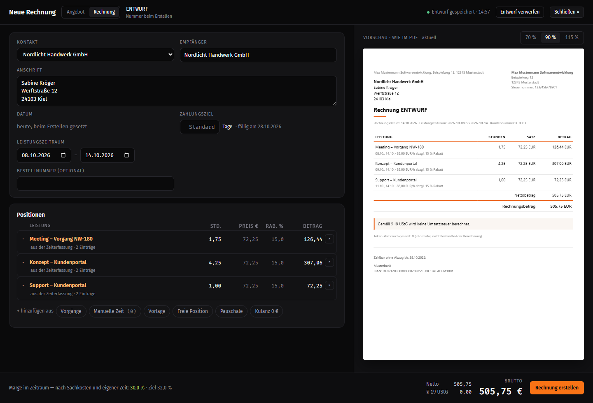

Live, while you work — each session shows its active time and agent time so
far, can be booked onto a job by hand and can get its own time model. The card
*You* shows your timer, today's working time and what comes next. The burn
rate is the list price of the last 60 minutes extrapolated to an hour: a
snapshot of how intensive the current session is, not an hourly cost:

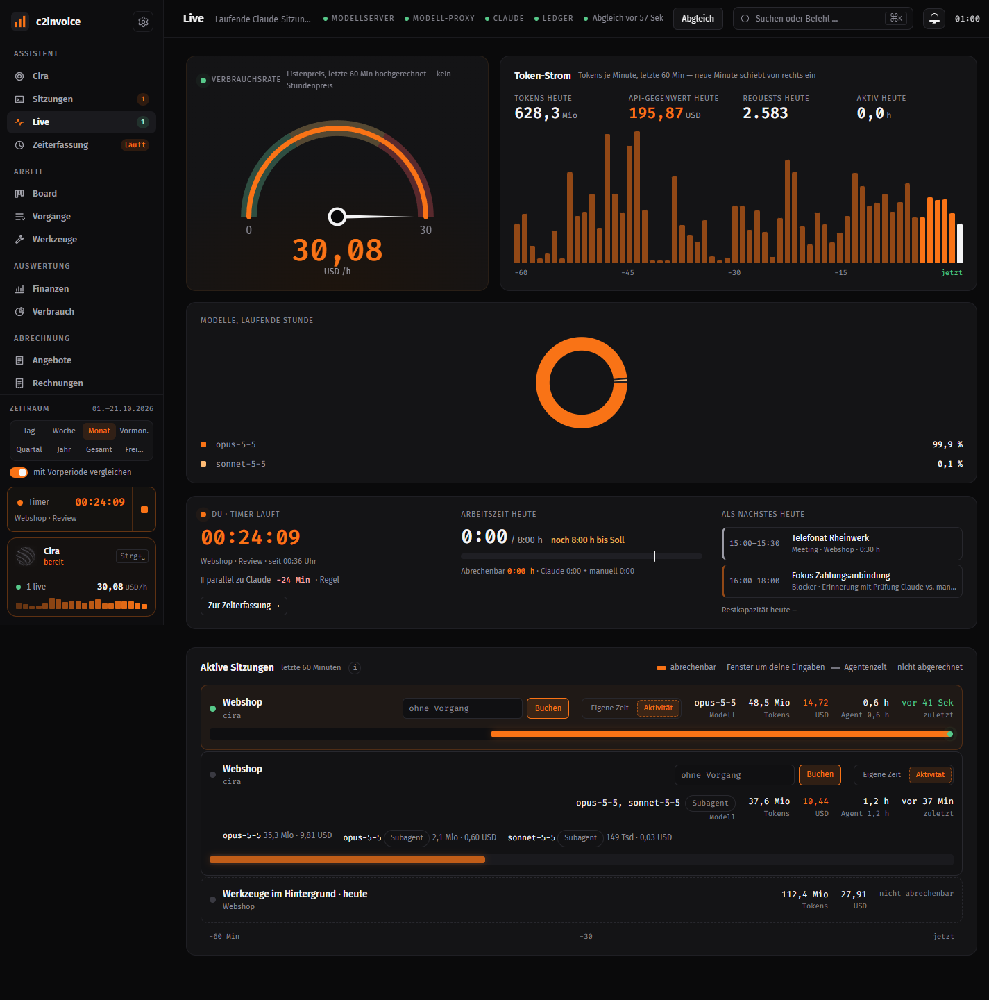

**Usage** shows tokens, cost and working time per project and model. Where the
tokens of background tools, MCP servers and skills went now lives on the
**Tools** page.

Light or dark: the interface follows your system by default, or you pick a
**light theme** or the dark one under Settings → Appearance (per browser).
Contrast was reworked for both; text meets WCAG AA contrast in either theme:

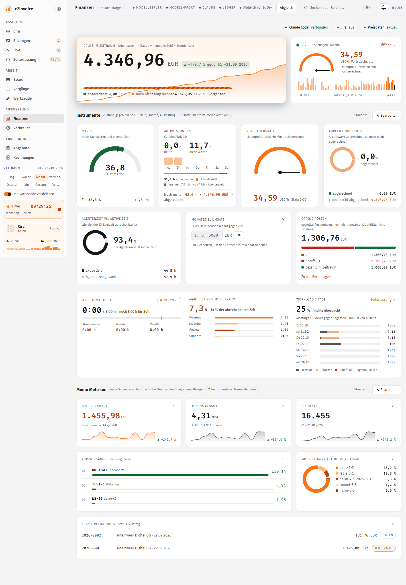

*Screenshots use anonymised project, job and customer names, sample time
entries, sample workspaces and a sample session, and show the German
interface; switch to English under Settings → Appearance.*

## Why this exists

Every tool in this space (ccusage, claude-code-templates, ccgauge, sniffly,
opcode) answers *how many tokens did I burn and what would the API have cost*.
None of them answer *what do I put on the invoice*. Between those two questions
sit four steps:

1. **Usage → working time.** Tokens are not hours. Only the gaps of up to 5
   minutes between two requests count as working time. Longer gaps — thinking
   it over, a meeting, another project, the end of the day — are dropped and
   never reach the invoice. Measured on real data: of a 9.1-hour span, 1.6
   hours were work. The other 82% is not billed.
2. **Working time → revenue.** Hourly rate per client, discounts, and the work
   assigned to the right job.
3. **Revenue → margin.** The API list price is not your cost. Your subscription
   is, proportionally — and above all, your own working time is.
4. **Margin → invoice.** Sequential numbering, legally required fields,
   immutable issued documents, cancellation instead of deletion.

*Published as `devbill` until version 1.0. Renamed in 1.1 to avoid confusion
with an unrelated commercial product of the same name. Same tool, same repo —
the old GitHub URL redirects here, and nothing in your setup needs changing.*

## Quick start

```bash
git clone https://github.com/RobSpct/c2invoice.git
cd c2invoice
cp config.example.json config.json     # Windows: copy config.example.json config.json
npm start                              # http://127.0.0.1:4747
```

Requires **Node 22.5 or newer** (uses the built-in `node:sqlite`), tested on
Node 24. **Zero dependencies** — there is no `npm install` step.

Session files are read from `~/.claude/projects` by default. That path works
on every platform, so there is normally nothing to set. If your logs live
elsewhere, point `jsonlDir` at them. If the directory cannot be found, the
server says so on startup instead of quietly reporting zeros.

Everything else has working defaults. Issuing invoices additionally requires
your business details under `rechnung.aussteller` — until those are filled in,
invoice creation refuses to run rather than producing an invalid document.

`config.json` is deliberately not tracked by git: it holds your business
address, rates and credentials.

```bash
npm test               # self-check of the calculation logic
node ingest.js         # ingest only, no server
npm run proxy          # only if you also meter local models via Ollama
```

### Pair your browser

c2invoice runs on `127.0.0.1` without a login. Since 3.0, **anything that
changes data needs a paired device**; reading stays open, so dashboards and
embeds keep working. The first time you save something, click *Pair device*:
a code appears on your desktop (a dialog on Windows, the server console
elsewhere), and you type it into the browser. Do this once per browser; paired
devices are listed under Settings → Devices and can be removed there. Without
this, any local process could pose as the browser and write.

### Workspaces

Sessions, Board and Tools work per **workspace**: the folders where you run
Claude Code. List them under `arbeitsbereiche` in `config.json` (name, short
code, colour and path; optionally the project name as it appears in the
ledger, a Jira project key and the path of a `TODO.md`). Short code and colour
can be changed under Settings → Workspaces; paths stay in the file on purpose.

### Cira's tiers

T0 works out of the box. For T1, run Ollama and set the local models under
Settings → Cira. T2 (Claude) is off by default; switch it on there and set the
monthly limit in euros. Sessions in your own terminal can report "waiting for
you" and their end to c2invoice once you run `node integration/hook-eintragen.js`
(it backs up `~/.claude/settings.json` and adds one hook; optional).

## Works with any issue tracker

**No tracker is required at all.** Jobs can be free-form names — you can book
any session onto `WEBSHOP-RELAUNCH` by hand from the Live page, and it flows
through reporting and invoicing like anything else.

If you *do* use a tracker, there are two independent layers:

**1. Recognition — already tracker-agnostic.** Job keys are detected from the
git branch name via a configurable regular expression:

```json
"ticketRegex": "([A-Z][A-Z0-9]{1,9}-\\d+)"
```

The default matches Jira (`PROJ-123`), **Linear** (`ENG-123`), Shortcut, YouTrack
and anything else using the `ABC-123` convention — unchanged. For a different
scheme (Trello card IDs, GitHub issue numbers), adjust the regex. The rest of
the pipeline treats the job key as an opaque string and never inspects it.

**2. Push-back — one adapter per tracker.** Writing results *back* into your
tracker as a comment is inherently tracker-specific: every API differs, so an
API key alone is not enough. `jira-sync.js` is the reference implementation and
is ~400 lines. A new adapter needs to expose `run({ db })` and gets wired into
one place in `server.js`. Contributions welcome — Linear and Trello are the
obvious next candidates.

Jira is fully optional: set `jira.enabled: false` and the entire tool works,
with the sync endpoint, background job, deep links and UI elements all disabled.

## What it measures

| Figure | Meaning |
|---|---|
| Tokens | Input, output, cache-read and cache-write, deduplicated per request |
| API equivalent | What the same usage would have cost at API list prices |
| Subscription share | Your actual cost — the plan price spread over measured usage |
| Active time | **Your** working time: a window around each of your own inputs. This is what gets billed |
| Agent time | How long the AI ran per session, including when it worked on its own. Shown, never billed |
| Work value | Active time × hourly rate, per client and per job |
| Contribution margin | Work value − direct costs |
| Margin | Contribution margin − (hours × your own cost rate) |

Every figure carries its reference in the label. Not "margin", but "margin —
after direct costs and own time". A missing cost block is invisible otherwise.

Two cost figures sit side by side on purpose. **API equivalent** is what the
same usage would have cost at API list prices — a reference, not a bill.
**Subscription cost** is what you actually paid for the period shown: your plan
price, spread over the months it covers. The gap between them is usually large,
and it is the reason the margin never uses the list price.

### Billable time is your time, not the AI's

An agent that works alone for forty minutes has not worked forty minutes of
*your* time. Two rules keep the hours on an invoice defensible:

**1. Only the window around your own inputs counts.** An input is a typed
prompt, a slash or shell command, an interrupt, or an answer to a question the
agent asked (a choice, a plan approval, a rejected tool call). Tool results,
subagents and programmatic runs (`claude -p`) are not inputs. Each input gets
half the idle threshold before and after it (`gapMinutes`, default 5, so ±2.5
minutes):

- Two inputs at most 5 minutes apart: the time between them counts in full.
- The agent then runs alone for 40 minutes: 5 minutes count, not 40.

**2. A minute counts at most once.** With several sessions open at the same
time, their time spans are merged first and then shared: two parallel sessions
give each job half a minute per minute. One hour on the clock is at most one
hour on the invoice, however many sessions were running. Background tools
(`overheadProjekte`, local models) step back behind the actual work.

**Agent time** is shown next to it: the AI's runtime per session, every log
line counting, parallel sessions counted separately. It tells you how much
machine time sits behind your own time and feeds no amount anywhere.

On the author's own logs (eleven weeks, 614 sessions) this turned 154 logged
hours into 64 billable ones. If you deliberately bill agent supervision as
working time, switch the **time model** to *Activity* under Settings (stored as
`"zeitmodell": "aktivitaet"` in `config.json`): then every log line counts
until a gap exceeds the threshold. Rule 2 applies either way, and the switch
takes effect immediately — issued invoices never change.

The setting under Settings is the **default**. You can override it where the
work actually differs:

| Where | Applies to | Stored in |
|---|---|---|
| Settings → *Hourly rates per project* (also in the contact record) | one project | `config.json`, `projektSaetze` |
| Jobs → open a job, switch *Time model* | one job | the database |
| Live → the session's *Time model* switch | one session, with or without a job | the database |

The narrowest choice wins: session, then job, then project, then the default.
Each switch shows the model that applies. Without a choice of its own that is
the inherited default; clicking the other value sets a choice, clicking the
inherited value again removes it, so the entry follows the default if that
changes later. A job whose sessions use different models shows
*varies by session*. Each invoice position stores the time model its hours were
counted with.

Rows read in before version 1.3 carry no input marker yet. As long as their
log files still exist, the next run adds it once; anything older keeps the
`aktivitaet` measure.

### Manual time

Meetings, reviews, concept work and support calls happen outside Claude Code.
**Time tracking** records them: a timer (it also sits in the sidebar while it
runs), or an entry after the fact, by clock or as a fixed duration. Each entry
is booked onto a job, a project, a customer or *internal*, with an activity and
an optional note.

Manual entries and Claude sessions run through the same time calculation.
Where they overlap, a rule proposes what counts, and you can change it per
overlap:

| Situation | Proposed | Why |
|---|---|---|
| Meeting (activity or calendar appointment) while a session runs | *Both* | Claude works on its own while you are in the meeting |
| Focus work while a session runs on *your inputs* | counted once | you cannot type into both at the same time |
| Same target, session on the *activity* time model | counted once | it is the same work, measured twice |
| Different target | *Both* | two pieces of work, one each |

The four choices are *Both*, *Claude only*, *My time only* and *Neither*;
*Neither* puts the overlap on the invoice as a goodwill line at 0.00 EUR. *Both*
is the one case where an hour on the clock can become more than an hour on the
invoice — you choose it, it is never applied silently to focus work.

After the overlap is taken out, the counted time is rounded up to a step
(`rundungMinuten`, default 5; per project via `projektSaetze.<project>.rundung`).
The raw time is kept. Activities can have their own hourly rate; otherwise the
project rate applies, discount included. *Internal* time is never billed but
counts as own cost in the margin. The daily target (`tagessollStunden`,
default 8) is the measure for today's working time and the workload view.

On the invoice, manual time gets positions of its own, per entry or grouped
per activity. Manual hours and Claude hours never share a position. Invoiced
entries are locked; cancelling the invoice unlocks them, and the issued
document stays unchanged.

### Where the tokens went

Beyond *how much*, Analysis → Tools answers *what consumed it*. Requests are
attributed to the MCP server that triggered them and to the skill that was
active at the time — skills as a ranked bar chart, servers as areas in
proportion to their share; a server can be opened to show its individual tools. On real data this surfaced that a single context tool
accounted for the bulk of one server's spend — the kind of thing a flat list of
a hundred rows hides.

Two separate lists on purpose: an MCP server *causes* the request, so the
tokens are genuinely its own. A skill does not — it adds text to a request that
was happening anyway. Its row says *how much ran while this skill was active*,
not *how much the skill cost*. Read as cost attribution, that number would be
wrong, so the page says so rather than letting you assume otherwise.

This section changes no billing figure. It is marked as such in the interface,
because the numbers above it do feed invoices and the difference matters.

### Accuracy

Claude Code writes the same API request to the log **multiple times** (one line
per content block, all carrying identical usage figures). Summing naively
overcounts by more than 100%. `c2invoice` keeps only the latest state per
`requestId`. Verified against `ccusage` over a full month: **0.02% deviation**
($2076.67 vs $2076.65).

**Models without an exact price are flagged** instead of sitting silently in a
total. If the price list does not know a model, one of two things happens: a
similarly named model exists (its price is used, flagged *estimated*), or none
does (the request counts as 0 USD, flagged *no price*). Analysis names the
affected models. Once the price list carries the model, the amount is
recomputed from the stored token counts and the flag disappears.

### Local models

Local models (Ollama and anything speaking its API) produce no billing data of
their own. An optional proxy sits between your tool and Ollama and records
usage, which is then billed at a configurable flat rate per million tokens
rather than invented API prices.

## Invoicing

- Sequential numbering per year (`2026-0001`), enforced by a unique constraint
- **Issued invoices are immutable**: positions, issuer and amounts are frozen as
  a JSON snapshot at creation time. Correcting an hourly rate later cannot
  retroactively alter a document you already sent.
- Never deleted, only cancelled — the original is marked void, the correction
  gets its own number with negative amounts
- PDF export via headless Chrome or Edge, no extra dependency
- Quotes have their own separate numbering, so an unaccepted quote never leaves
  a gap in your invoice sequence. Their status is *open*, *accepted* or
  *declined*; *expired* and *invoiced* follow automatically, and any quote not
  yet invoiced can be turned into an invoice
- **Document editor** with a live preview. Choosing a contact pre-selects the
  jobs of their projects; jobs that belong to no customer, or that started
  before the service period, are flagged. Drafts are kept in the browser until
  the document is created
- **Payments** are recorded next to an invoice, never inside it — the issued
  document stays as it was. Partial payments are fine; a payment just recorded
  can be undone for a few seconds
- **Overdue at a glance:** an invoice past its due date that is not fully paid
  is red in the list, has its own filter and adds to the overdue card. The
  Invoices page also shows the open total, payments received in the period and
  the average time to pay
- **Table or Kanban** for invoices and quotes. Invoices sit in columns by
  payment state; dropping a card on *Paid* books the open balance (with undo).
  Quotes move between open, accepted and declined by drag or menu; *invoiced*
  only comes from turning a quote into an invoice
- **Contacts** as a pipeline of leads, open quotes and customers, with a record
  per contact: contact persons, documents, projects with rate, discount and
  time model, jobs, and revenue paid and open
- **Manual time** from Time tracking: *Bill open entries →* opens the editor
  with the customer's open entries; they are locked once the invoice exists
  (see [Manual time](#manual-time))

### E-invoice (XRechnung)

Every issued invoice can be downloaded as a structured file from the Invoices
page (the invoice's menu, *Load XRechnung*): EN 16931 in UN/CEFACT CII syntax, German CIUS **XRechnung 3.0**. The file
is the original for the recipient; the HTML view and the PDF are the reading
copy of the same snapshot. Nothing is recalculated on export — every amount
comes from the stored invoice.

The standard asks for more than § 14 UStG does, so a few fields must be set:

| Where | Field |
|---|---|
| Settings → issuer data | email, phone, IBAN; address with postcode and city on the last line |
| The client's contact | email; address with postcode and city on the last line |
| optional | buyer reference, country (default DE), supplier number, order number per invoice |

Every contact has a **customer number**. It is assigned automatically
(`K-0001`, derived from the contact's id, never reused) unless you enter your
own; numbers must be unique, and the `K-0000` pattern is reserved for the
automatic ones. The customer number is printed on every invoice and written to
the e-invoice as the buyer identifier (BT-46).

The **buyer reference** (BT-10) is mandatory in XRechnung. Small clients rarely
have one, so if the contact leaves it empty, the customer number fills it. If
a client does specify one, theirs wins: the Leitweg-ID for German public
authorities, otherwise a cost centre, order or project code. For authorities
the Leitweg-ID also serves as the electronic address.

If something is missing, the export refuses and names the field — a file with
an empty mandatory field would look finished and be rejected at the
recipient's end. Because issued invoices are immutable, nothing can be added
afterwards: complete the data, cancel the invoice, issue it again. The
interface therefore tells you what is missing the moment you create an invoice.
Invoices from before version 1.3 do not carry the new fields.

**Limits:** no transmission (upload, email or Peppol is up to you), no embedded
attachments, no cash discount terms, one VAT rate per invoice, no reverse
charge, no ZUGFeRD PDF.

**Checked with** KoSIT's official validator (version 1.6.3) and the
XRechnung 3.0.2 validator configuration of 2026-08-31 — the CII D16B schema,
the EN 16931 Schematron and the XRechnung Schematron — across seven cases:
standard VAT, small-business exemption, flat-rate position, cancellation,
public authority with Leitweg-ID, client abroad, small client with nothing but
the customer number. All seven were accepted with no
error and no warning; the same invoice with a wrong total was rejected. This is
the check the receiving platforms run, but it is no substitute for their own
acceptance: before invoicing a public-sector client for the first time, upload
one invoice to the test environment of the receiving platform. KoSIT publishes
new versions on 31 January and 31 July, valid six months later; the identifier
lives in `erechnung.js`.

**Jurisdiction note:** the invoicing module implements **German** requirements
(§ 14 UStG mandatory fields, § 19 small-business exemption, 19% VAT). VAT rate
and small-business status are configurable, but the required-field logic assumes
German law. If you extend this for another country, please make it configurable
rather than replacing it.

## Calendar

Appointments show up in the week view and on today's timeline, so a meeting
can be booked with one click once it has started. c2invoice **only reads**
calendars, every 5 minutes, and needs no account with anyone:

- **ICS** — any subscription link: the secret iCal address of a Google
  Calendar (*Settings → under "Settings for my calendars" click your calendar,
  not "Add calendar" → Integrate calendar → Secret address in iCal format*),
  Outlook, Apple. `webcal://` works too. In Google Workspace an admin can turn
  the secret address off.
- **CalDAV** — Apple iCloud, Nextcloud, Fastmail and others. HTTPS only, user
  name plus an app password from an environment variable.

**Connecting an ICS calendar:** paste the address under *Time tracking → +
Connect calendar* or *Settings → Calendar* and click *Connect*. The server
checks it, fetches it once as a test and stores it in `config.json`; the
appointments are there right away, no restart. A calendar address is an access
key: after saving it is never shown again, only its host and sync status.
*Remove* takes it out again; appointments you already booked stay.

**CalDAV** needs a password and is therefore set in `config.json` only, with
the password in an environment variable:

```json
"kalender": [
  { "id": "cloud", "name": "Nextcloud", "art": "caldav", "url": "https://cloud.example.com/remote.php/dav/calendars/me/personal/",
    "benutzer": "me", "passwortEnvVar": "C2INVOICE_CALDAV_PASSWORD" }
]
```

Restart the server after editing the file.

- A job key, project or customer name in the title is offered as the target.
  Nothing is booked until you confirm it; a booked appointment cannot be booked
  twice, and a sync never removes it.
- **Meetings and blockers** can also be created in c2invoice, or by dragging
  across the week. *Open in Google Calendar* opens Google's own event form,
  pre-filled with title, time and the invited contact persons; you save it
  there and Google sends the invitations. With a calendar connected, the event
  is marked *waiting for Google* until the sync brings it back; then both are
  merged (target, reminder and booking carry over) instead of showing twice.
  Not back after a day: *not found in Google*, with *Keep*, *Open again* or
  *Delete*. No sign-in is involved, so later changes are made by hand in both
  places.
- **At the start of a blocker** the bell shows a reminder until you
  dismiss it (at most a day), the tab title counts it, and a desktop
  notification appears if you allow it. It comes with the matching action: *Start timer*, or
  *Start timer · Accompany* if Claude is already working alone on that target.
  The action starts the timer right away only if you set the blocker's target
  by hand; otherwise it pre-fills the timer card and waits for your click.
- Events repeating daily or weekly are expanded; other recurrence rules show
  their first occurrence. Signing in to Google or Microsoft is planned for 2.1:
  c2invoice then reads without the secret address and saves events itself.

## Obsidian vault: briefings, memory, "remember"

Give a workspace in `config.json` `"art": "vault"` (an Obsidian folder) and
c2invoice reads it every 30 seconds. It writes to the vault only when you
click to approve.

- **Memory** shows your notes as a graph: notes are nodes, wikilinks are
  edges, colours come from Obsidian's colour groups (`.obsidian/graph.json`)
  or Settings → Vault. A note with `originSessionId` in its frontmatter shows
  the session it came from: job, tokens, API equivalent and invoice. Search
  ranks titles over tags over text; *Ask Cira* answers from the top three hits
  with your local model.
- **Briefings** lists the reports in `vault.briefingsOrdner` (default
  `Briefings/`, plus `reports/`). To-dos (`- [ ]`) can be ticked off; only
  that line changes. A summary is made on click with the local model.
- **Monthly report:** from the 1st of a month, 7 am, a report on the previous
  month waits under *Needs you* (hours, value of work, invoices as count and
  total, API equivalent per workspace). No invoice numbers or recipients, since
  vaults are often shared. Approving saves it to
  `Briefings/reports/YYYY-MM-c2invoice.md`.
- **"Merke dir …"** (remember …) in a chat with Cira drafts a note in
  `memory/` with a top-level `tags:` entry and a line in `memory/MEMORY.md`.
  Nothing is written until you approve, and nothing at all if the file changed
  since the draft.

## Voice

Cira can listen and read aloud. Both are optional.

- **Reading aloud** works without setup, using your browser's voice, locally.
  Choose under Settings → Cira when answers are read: automatically (after a
  spoken question and for the daily report), always or never. Briefings have
  a read-aloud button.
- **Listening** (push-to-talk) needs a local
  [whisper.cpp](https://github.com/ggml-org/whisper.cpp/releases) server;
  without it there is no microphone button. Speech recognition always runs on
  your machine. Unpack `whisper-bin-win-cuda-12.4.0-x64.zip` (NVIDIA) or
  `whisper-bin-x64.zip` (CPU only, much slower) and a model such as
  `ggml-large-v3-turbo-q5_0.bin` (about 1 GB of video memory), then point
  `config.json` at both:
  ```json
  "sprache": { "stt": { "exe": "D:/models/whisper/whisper-server.exe", "modell": "D:/models/whisper/ggml-large-v3-turbo-q5_0.bin" } }
  ```
  c2invoice starts whisper on first use (port 8178) and stops it after 10 idle
  minutes to free the video memory. Press the speak button in the cockpit or
  dock, or Ctrl+Space with an empty input; 0.8 s of silence sends the
  question, Esc discards it or stops reading. Embedded views such as Obsidian
  usually get no microphone; reading aloud still works there.
- **ElevenLabs** (optional) gives a better voice, but the text leaves your
  machine, customer names and amounts included. Set `ELEVENLABS_API_KEY` as a
  user environment variable and restart; the key never goes into
  `config.json` or the interface. Then pick ElevenLabs and a voice ID under
  Settings → Cira → Voice. On the free plan only the built-in voices work via
  the API (Matilda, for example); Voice Library voices need a paid plan. A
  monthly character limit switches back to the browser voice in time, repeated
  texts come from a local cache, and if ElevenLabs fails the browser speaks.

Cira's voice speaks German for now, like Cira itself.

## Language

The interface speaks **English and German**. Pick one under Settings →
Appearance; the choice is remembered per browser, and numbers and dates follow
it.

The **invoice document stays German** on purpose. German invoicing law ties
its mandatory fields to German terms, so a translated invoice would not be
legally sound. Only the interface is translated.

Source comments and configuration comments remain German.

## Optional: run it in the background (Windows)

`integration/autostart.ps1` registers a scheduled task that keeps the server
running and restarts it if it dies. `integration/start-hidden.vbs` starts it
without a console window. Both are optional; `npm start` is enough.

## Roadmap

- Flows: automations with trigger, condition and action, dunning, sending
  documents, recurring invoices
- Acceptance links for quotes, a shared mailbox per customer and job
- A quarterly tax package for your accountant
- Linear and Trello sync adapters
- Partial billing of long-running jobs across month boundaries
- ZUGFeRD: the e-invoice embedded in the PDF

## Contributing

See [CONTRIBUTING.md](CONTRIBUTING.md). Short version: no dependencies, every
calculation gets a check that actually fails when the logic breaks, and tests
must not depend on your own `config.json`. Tracker adapters are the most
useful thing to contribute right now.

## License

AGPL-3.0. If you modify this and offer it as a service, your changes must be
made public.
